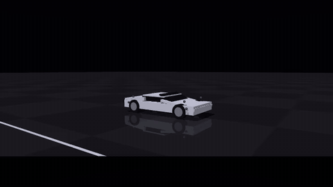
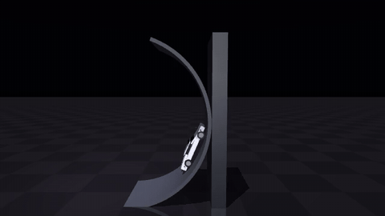
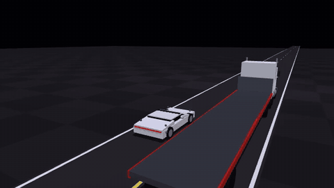

# Roadster stunts in MuJoCo

I loved Tesla's Roadster demo (Oct 15, 2026). This is my own implementation of how the control for its kickflip
and ramp stunts could work, plus one stunt of my own, all in simulation. Not Tesla's code; every number is an
estimate.

| Kickflip | Ramp | Mine: onto a moving semi |
|---|---|---|
|  |  |  |

## How it works

The car has 12 on/off cold-gas jets and a limited air tank. Three tools, one per job:

1. **Plan** the whole flight offline with trajectory optimization (CasADi + IPOPT).
2. **Correct** in flight with LQR on the car's attitude, 100 times a second.
3. **Land** with model predictive control, 50 times a second, solved by [TinyMPC](https://tinympc.org/).

With the car 4% heavier, jets 3% weaker and a gust mid-flip, replaying the planned jet timing without feedback
hits the ground at 8 m/s; with feedback it lands at 0.9 m/s. On the ramp, Tesla says fans under the car hold it
on; here that is a constant 20 kN of suction.

## Run

```bash
conda env create -f environment.yml && conda activate roadster && pip install -e .
python scripts/run_kickflip.py && python scripts/run_ramp.py   # plans and logs -> data/
MUJOCO_GL=egl pytest                                          # tests
python -m video.tts && MUJOCO_GL=egl python -m video.assemble  # the explainer video -> out/
```

`roadster/` has the car model, planners and controllers; `video/` turns the logs into the narrated video.

## Credits

Built on [MuJoCo](https://github.com/google-deepmind/mujoco), [CasADi](https://web.casadi.org),
[TinyMPC](https://tinympc.org), [OSQP](https://osqp.org), [Manim](https://www.manim.community) and
[Kokoro-82M](https://huggingface.co/hexgrad/Kokoro-82M). Not affiliated with Tesla or SpaceX. Congrats to both
teams on a great demo.

Khai Nguyen. Released under the license in LICENSE.
